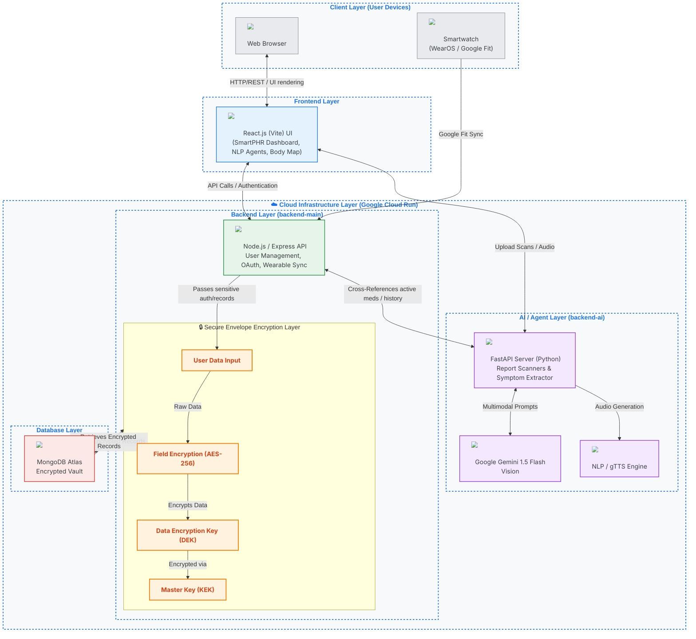

# SmartPHR System Architecture Diagram

This diagram visualizes the actual system flow extracted from the codebase and README, including the requested Secure Envelope Encryption layer.

## Architecture Diagram

